<div align="center">

# ♞ elo101

**Free chess game review that knows who was playing.**<br>
Every move is judged for *your* rating, and the win chances account for both players' ratings and clocks.

[](https://chromewebstore.google.com/detail/elo101-game-review/hlhdgbelomlkdmiajjahhojecfikcnkl)
[](https://github.com/NazmulHayat/elo101/actions/workflows/ci.yml)
[](LICENSE)


<a href="https://elo101.vercel.app/"></a>
&nbsp;
<a href="https://chromewebstore.google.com/detail/elo101-game-review/hlhdgbelomlkdmiajjahhojecfikcnkl"></a>

No account. The chess engine and the models run in your browser.<br>
The Chrome extension adds a one-click **Review** button to Chess.com and Lichess.

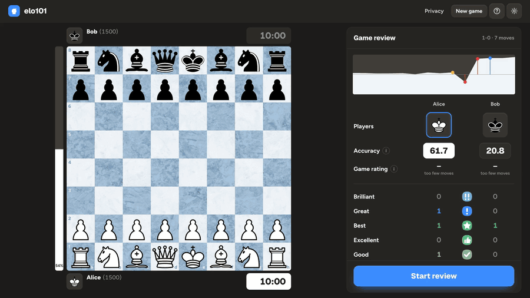

[The idea](#the-idea) · [What you get](#what-you-get) · [How it works](#how-it-works) · [Results](#results) · [Engineering](#engineering-highlights) · [Run it](#run-it-locally)

</div>

## The idea

A chess engine like Stockfish scores a position with one number, no matter who is playing. But a position that is easy to win for a grandmaster can be hard for a beginner.

elo101 learned from millions of real Lichess games what actually happens from a position, given the **players' ratings** and **time left on the clock**. Here is one position where the engine says White is clearly winning (+5.2), but the win still takes two precise sacrifices:

<picture>
  <source media="(prefers-color-scheme: dark)" srcset="docs/images/same-position-dark.png">
  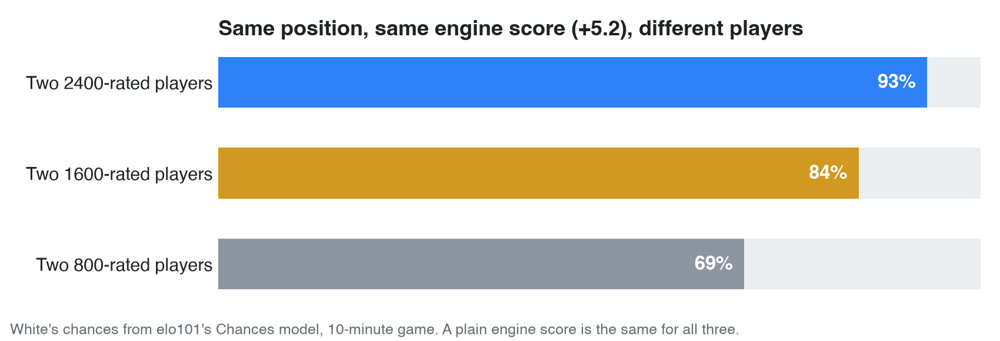
</picture>

We call this number **expected points**: the score a player can expect from here, where a win is 1, a draw ½ and a loss 0. Everything in elo101 is built on it:

- **Chances:** who is likely to win from here, with these ratings and these clocks.
- **Move labels:** how many expected points a move threw away, for a player of your rating.

## What you get

- **Import any game.** Search a Chess.com or Lichess username, paste a game link, or paste a PGN.
- **Every move labelled and explained.** From Brilliant to Blunder, with the better move shown on the board.
- **Chances graph.** See where the game turned.
- **Accuracy and game rating** for both players, like the big sites.
- **Retry your mistakes.** Jump back to the position and find the better move yourself.
- **Works on your phone**, with no account and no upload of your games to our servers.

<table>
  <tr>
    <td width="50%">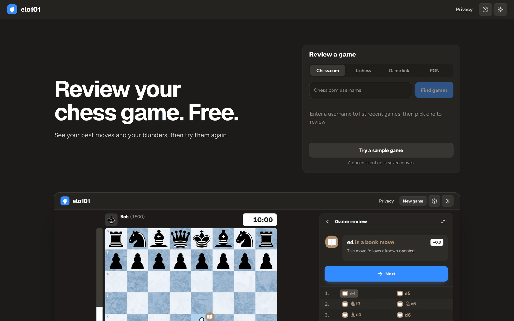</td>
    <td width="50%">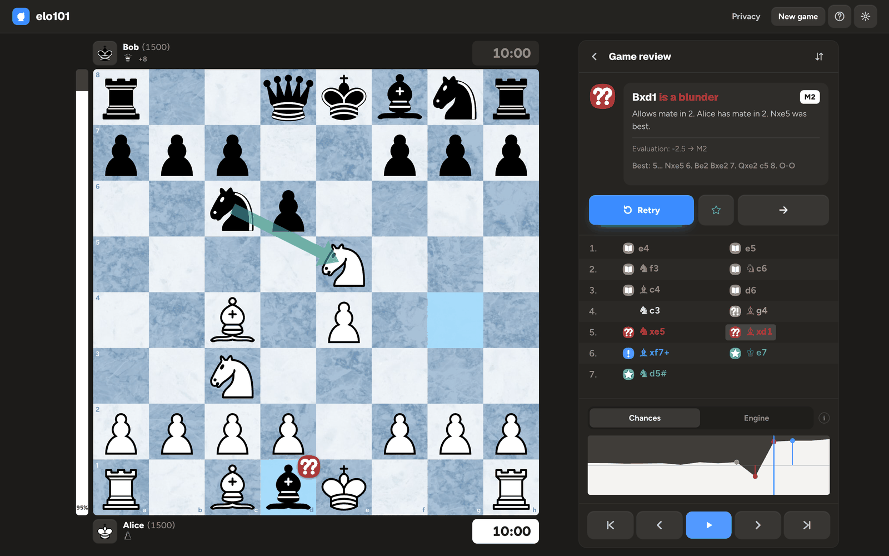</td>
  </tr>
  <tr>
    <td align="center"><b>Import</b> from Chess.com, Lichess, a link or PGN</td>
    <td align="center"><b>Review</b> every move, labelled and explained</td>
  </tr>
  <tr>
    <td>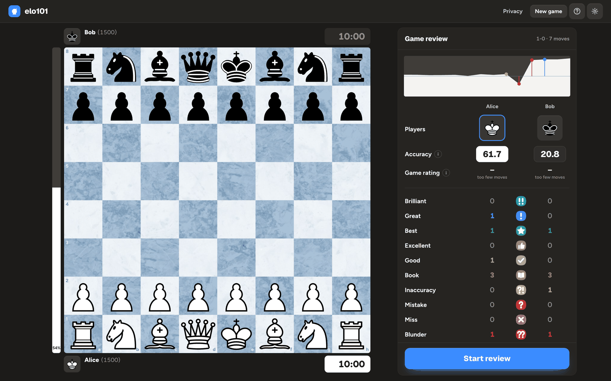</td>
    <td>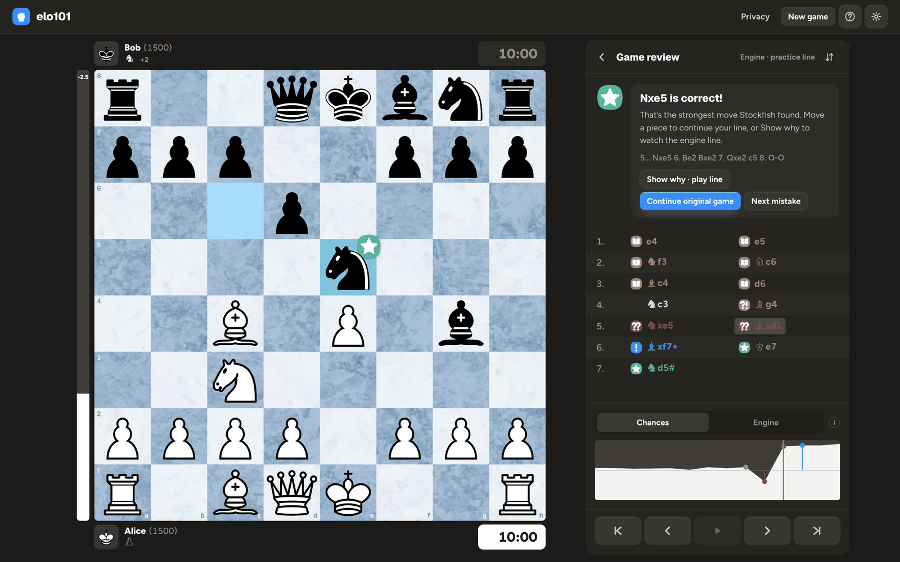</td>
  </tr>
  <tr>
    <td align="center"><b>Summary</b>: chances graph, accuracy, labels</td>
    <td align="center"><b>Retry</b> your mistakes on the board</td>
  </tr>
</table>

<p align="center">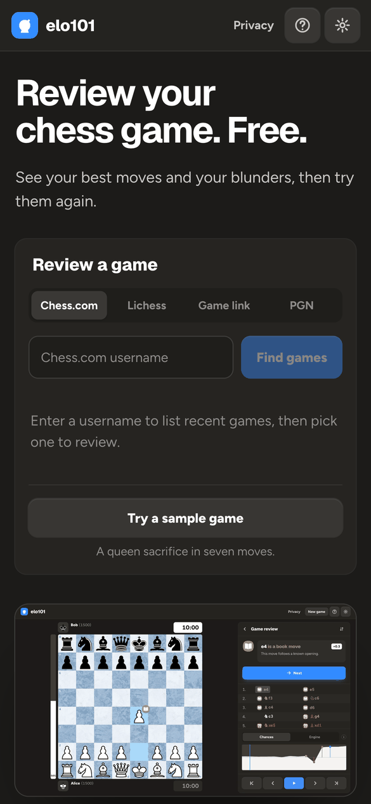</p>

### What the labels mean

Each move is compared with the engine's best move. The label depends on how much of your expected score the move gave away, as judged for players of your rating.

| Label | Meaning |
|---|---|
| **Brilliant** `!!` | The best move, and a real sacrifice: the opponent takes the material and you stay material down, but the position holds. Rare: about 1 in 40 games. |
| **Great** `!` | The only good move, or the one move that keeps you winning (or keeps you from losing). |
| **Best** | The engine's top move. |
| **Excellent** / **Good** | Gives away less than 2% / 5% of your expected score. |
| **Book** | A known opening move. |
| **Inaccuracy** `?!` | Gives away 5–10%. |
| **Mistake** `?` | Gives away 10–20%. |
| **Miss** | Your opponent just made a mistake and you didn't take advantage of it. |
| **Blunder** `??` | Gives away 20% or more. |

### Chrome extension

<a href="https://chromewebstore.google.com/detail/elo101-game-review/hlhdgbelomlkdmiajjahhojecfikcnkl">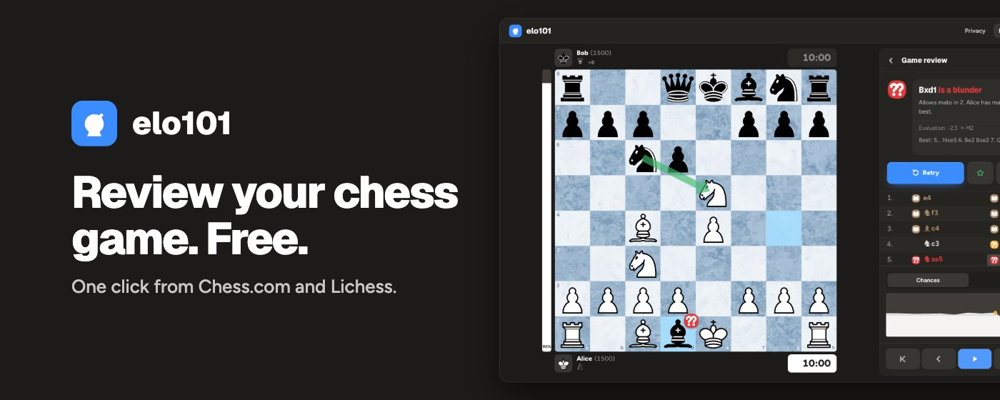</a>

**[Add to Chrome, free →](https://chromewebstore.google.com/detail/elo101-game-review/hlhdgbelomlkdmiajjahhojecfikcnkl)**

When your game ends on Chess.com or Lichess, an elo101 button appears on the page and one click opens the review. It does nothing while you are playing, and it also shows up next to Chess.com's "Daily limit reached" message. Source: [`extension/`](extension/).

## How it works

There are two halves: training the models once on a laptop (Python), and reviewing games in your browser (TypeScript).

### 1. The data

Scoring millions of positions with Stockfish would take about 60 days of computer time. But about 11% of Lichess games have already been analysed by Lichess's own servers, and those scores are saved in the public game files. Reading them out gave **46 million scored positions in 15 minutes**.

<picture>
  <source media="(prefers-color-scheme: dark)" srcset="docs/images/data-funnel-dark.png">
  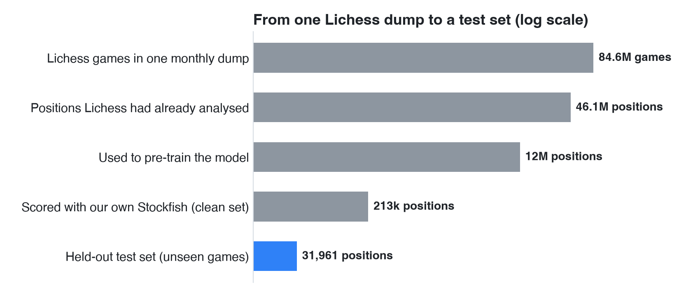
</picture>

### 2. Training

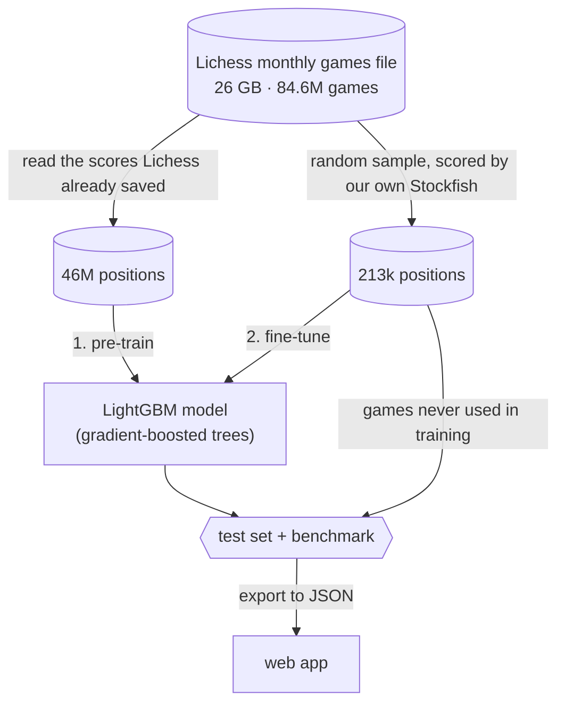

The model sees the engine score, both ratings, the time control, both clocks and the stage of the game, and predicts the expected score. Pre-training on the large set and then fine-tuning on the clean set beat using either one alone.

### 3. Reviewing a game in your browser

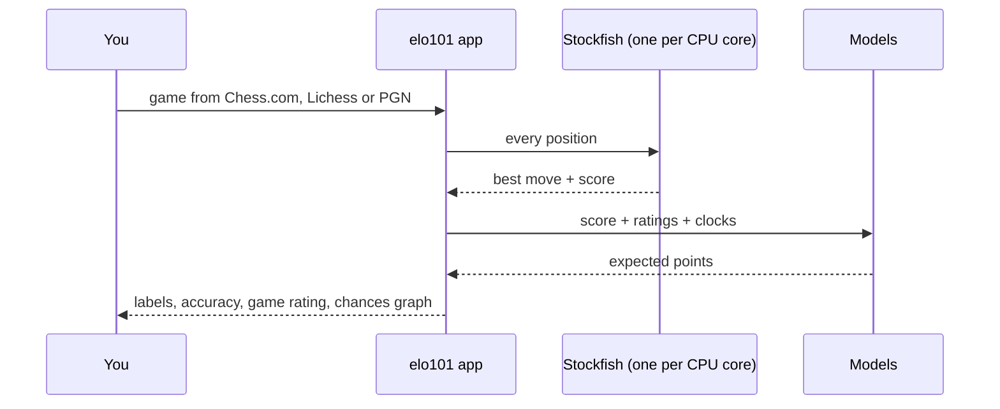

Nothing is sent to a server: Stockfish runs as WebAssembly and the models run as plain TypeScript.

### 4. How one move gets its label

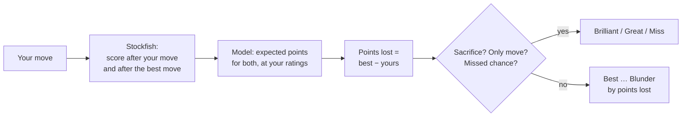

Moves are judged by a separate model that looks only at the board, not the clock. A clock-aware model is right that bullet games are often decided by time, but that made hanging a queen in bullet look harmless. Full details are in the [methodology](docs/methodology.md).

## Results

All numbers are from **31,961 positions in games the model never saw** during training.

**elo101 predicts game results 11.5% better than the formula Lichess uses**, and 17% better in bullet, where the clock matters most. The score is *log loss*: lower means the predicted chances were closer to what really happened.

<picture>
  <source media="(prefers-color-scheme: dark)" srcset="docs/images/results-dark.png">
  
</picture>

| Model | Training data | Log loss ↓ |
|---|---|---|
| **elo101 (shipped)**: pre-train + fine-tune | 12M Lichess-scored → 154k Stockfish-scored positions | **0.575** |
| PyTorch neural network (best of 3 runs) | 181k Stockfish-scored positions | 0.575 |
| elo101, Stockfish-scored data only | 181k Stockfish-scored positions | 0.579 |
| Same model, engine score only (no ratings or clocks) | 181k | 0.627 |
| Lichess's win% formula | none | 0.649 |

<table>
<tr>
<td width="42%">
<picture>
  <source media="(prefers-color-scheme: dark)" srcset="docs/images/calibration-dark.png">
  
</picture>
</td>
<td>

**When it says 70%, players score about 70%.** Grouped into 10 bins, every prediction is within 1.5 points of the real result.

- **Ratings and clocks matter:** the same model without them does much worse (0.627 vs 0.575).
- **Pre-training helps:** better than clean data alone, and the gain holds up statistically (95% confidence interval, resampling whole games).
- **More data stopped helping:** 25M positions were no better than 12M.
- **The neural network ties:** it matches the shipped model without the big dataset, but doesn't beat it, so the smaller, faster model ships.

</td>
</tr>
</table>

### Move labels, checked against Lichess

Labels are tested on a fixed benchmark: 450 real games, 300 puzzles and 64 hand-checked positions. **Every blunder elo101 reports is also a blunder on Lichess**, and all 64 hand-checked positions get the right label.

<picture>
  <source media="(prefers-color-scheme: dark)" srcset="docs/images/benchmark-dark.png">
  
</picture>

**Game rating follows accuracy.** The more accurate player never gets the lower game rating (0 exceptions in 40,000 test games), and the player with the higher game rating won 95.6% of decisive games. [How the benchmark works →](docs/benchmark.md)

## Engineering highlights

| | |
|---|---|
| ⚡ **46M training positions in 15 minutes** | read from a 26 GB games file instead of ~60 days of engine time |
| 📉 **11.5% better predictions than Lichess's formula** | on 31,961 test positions; 17% better in bullet |
| 🎯 **100% of our blunders confirmed by Lichess** | fixed benchmark of 450 games, 300 puzzles and 64 hand-checked cases |
| 🧠 **LightGBM vs PyTorch, measured** | a neural network ties the shipped model, so the smaller one ships |
| 🌐 **Runs fully in the browser** | Stockfish WebAssembly on every core; the trained trees run as TypeScript |
| 🔁 **Python and TypeScript give identical results** | 58 full game reviews must match the Python version exactly, in CI |

<details>
<summary><b>Problems worth reading about</b></summary>

- **Skipping the work was the biggest speedup.** Instead of running Stockfish on millions of positions, a streaming reader pulled the scores Lichess had already saved: 46M positions in 15 minutes.
- **A fair comparison for every move.** The played move and the best move are scored in exactly the same setting, so a small bias in the model cancels out instead of showing up as a fake loss on every move.
- **Matching Lichess's accuracy number** exposed an undocumented detail: each move's accuracy is floored at 1 before averaging.
- **Moving from a server to the browser** turned up a draw-by-repetition rule that the two chess libraries handled differently, and needed a 50× faster check of piece trades.
- **Same game, same review, every time.** Stockfish's memory carried over between positions; clearing it took repeatability from 78% to 100%.

All 28 problems, with before and after numbers: [engineering log](docs/engineering-log.md#problems-solved).

</details>

## Run it locally

**You'll need:** Node 22+ for the app. For the Python side, Python 3.11+ and [Stockfish](https://stockfishchess.org/download/) on your `PATH`.

**The app:**

```bash
cd web && npm install && npm run dev        # http://localhost:5173
```

**Tests and results:**

```bash
python -m venv .venv && source .venv/bin/activate
pip install -r requirements.txt
make test                                   # Python tests
make benchmark                              # score the shipped model on the benchmark
python -m ep_model.scripts.make_figures     # redraw the charts in this README
make help                                   # everything else
```

To train the model from scratch on a Lichess games file, see the [training pipeline](docs/training-pipeline.md).

## Tech stack

| Area | Tools |
|---|---|
| ML & data | Python, LightGBM, PyTorch, pandas, Parquet, zstandard, multiprocessing |
| Chess | Stockfish 18 (native + WebAssembly), python-chess, chess.js |
| App | React 19, TypeScript, Vite, Web Workers, Chrome extension (Manifest V3) |
| Quality | pytest, Vitest, ESLint, GitHub Actions |

<details>
<summary><b>Project structure</b></summary>

```
ep_model/           Python: data pipeline, models, reference review
  sampling/         read the Lichess games file, sample positions
  labeling/         score positions with a pool of Stockfish engines
  harvest/          pull out the scores Lichess already saved
  training/         LightGBM, PyTorch, evaluation
  review/           move labels, accuracy, game rating
  benchmark/        fixed benchmark sets and scorer
web/                React + TypeScript app (runs fully in the browser)
  src/review/       TypeScript version of the review + tests against Python
  src/engine/       Stockfish WebAssembly worker pool
extension/          Chrome extension for Chess.com and Lichess
tests/              Python tests
docs/               methodology, benchmark, engineering log
```

</details>

## Further reading

- [Methodology](docs/methodology.md): how the models are built and how labels are decided
- [Benchmark](docs/benchmark.md): the fixed test sets and full scores
- [Engineering log](docs/engineering-log.md): every problem solved, with numbers
- [Training pipeline](docs/training-pipeline.md): reproduce the model from raw data

## License and credits

Code: [MIT](LICENSE). Not affiliated with Chess.com or Lichess.

| Used | Source | License |
|---|---|---|
| Game data | [Lichess open database](https://database.lichess.org/) | CC0 |
| Chess engine | [Stockfish](https://stockfishchess.org/), run as a separate program | GPLv3 |
| Sounds | Lichess "standard" set ([details](web/public/sounds/README.md)) | Lichess's terms, not MIT |
| Board texture | `web/public/boards/ice.jpg`, recoloured from Lichess's `blue-marble.jpg` ([lichess-org/lila](https://github.com/lichess-org/lila)) | AGPLv3+ |
| Fonts | Figtree, Geist, Noto Sans Symbols 2 (Google Fonts) | SIL Open Font License |
